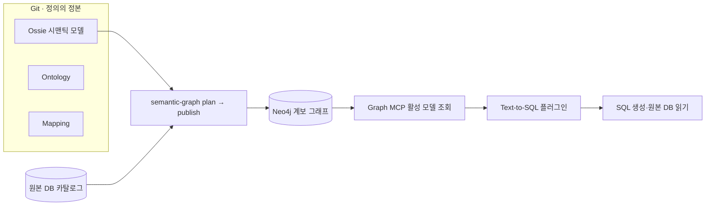

# Semantic Definitions

Text-to-SQL이 사용하는 시맨틱 모델과 업무 개념을 정의하고 시맨틱 정의에서 물리 DB 컬럼까지의 계보를 Neo4j에서 조회할 수 있도록 만드는 저장소입니다.

## 한눈에 보기

DB 스키마만으로는 `매출`에 배송비와 취소 주문이 포함되는지, 고객 ID가 사람을 뜻하는지 주문별 계정을 뜻하는지 알기 어렵습니다. 이 저장소는 지표 계산 규칙, 데이터셋 간 연결, 업무 개념을 YAML로 명시합니다. 정의를 검증하고 Neo4j에 게시하면 Text-to-SQL 플러그인이 Graph MCP의 활성 모델을 읽어 SQL을 만듭니다.

정의 파일은 **Git에서 관리하는 정본**입니다. Neo4j는 정의와 실제 DB 카탈로그를 연결해 만드는 조회용 그래프이며 정의를 수정하는 곳이 아닙니다.

| 하려는 일 | 문서 |
| --- | --- |
| 정의 파일과 승인 상태 이해하기 | [시맨틱 모델 작성 규칙](docs/semantic-model.md) |
| 그래프의 계보와 게시 절차 확인하기 | [GraphDB 계보와 배포](docs/graphdb.md) |
| 평가용 지표·예상값 해석하기 | [Olist 평가 지표](docs/evaluation.md) |
| 설계 선택의 이유 확인하기 | [설계 결정 기록](docs/decisions.md) |
| MCP 조회 도구 사용하기 | [Graph MCP 서버](https://github.com/zisu17/text2sql-mcp#readme) |

## 정의에서 조회까지



그래프 적재기는 Ossie 정의와 DB에서 관측한 테이블·컬럼을 대조합니다. `plan`에서 미해결 계보를 확인한 뒤 `publish`가 새 버전을 적재하고 활성 버전을 전환합니다. 온톨로지와 매핑은 별도 정의 파일로 유지하며 현재 GraphDB 적재 범위에는 넣지 않습니다. 일반 질문에서는 플러그인이 로컬 정의 파일을 읽지 않습니다. Neo4j 조회용 MCP 서버는 이 저장소가 아니라 [text2sql-mcp](https://github.com/zisu17/text2sql-mcp)에 있습니다.

## 정의 파일

| 파일 | 역할 |
|---|---|
| **Semantic Model** (`.ossie.yaml`) | 데이터셋, 필드, 조인, 지표와 승인 상태를 정의합니다. |
| **Ontology** (`.ontology.yaml`) | 업무 개념과 개념 간 관계를 정의합니다. |
| **Mapping** (`.mapping.yaml`) | 업무 개념을 시맨틱 모델의 필드에 연결합니다. |

Olist 예제에서는 `Customer`가 실제 사람을, `CustomerAccount`가 주문마다 발급되는 고객 ID를 나타냅니다. 이 구분은 고객 수와 주문 수를 혼동하지 않도록 돕습니다. [모델 작성 규칙](docs/semantic-model.md)에 더 자세히 설명했습니다.

## 저장소 구조

```text
definitions/olist/
  sales.ossie.yaml       주문·매출 시맨틱 모델
  sales.ontology.yaml    업무 개념과 관계
  sales.mapping.yaml     개념과 필드의 연결
graphdb/                 계보 계획 생성 및 Neo4j 게시
scripts/pick_metrics.py  평가용 지표 부분집합 생성
tests/                   계보 생성 검증
docs/                    모델·그래프·평가·설계 결정 문서
```

`definitions/<DB>/`는 하나의 DB 접속 범위이고 파일 하나가 그 안의 주제 영역입니다. 함께 계산하거나 조인하는 데이터셋은 같은 Ossie 파일에 둡니다.

## 시작하기

저장소 루트에서 다음 명령을 실행합니다. DB 데이터와 접속 정보는 저장소에 포함되지 않습니다.

### 정의 검증

`text2sql-plugin`의 `t2s` 명령을 사용합니다. `--static`은 DB 접속 없이 정의 파일을 검사합니다.

```bash
export SEMANTIC_MODEL="$(pwd)/definitions/olist/sales.ossie.yaml"
t2s check --static "$SEMANTIC_MODEL"
```

물리 DB와 지표 계산까지 확인하려면 `DATABASE_URL`을 설정합니다.

```bash
export DATABASE_URL='sqlite:////절대/경로/olist.db'
t2s check "$SEMANTIC_MODEL"
```

### 그래프 계획 및 게시

```bash
python -m pip install -e .
semantic-graph plan definitions/olist/sales.ossie.yaml \
  --tenant olist --source-id olist
```

계획의 `diagnostics`가 비어 있고 Neo4j 접속 정보가 준비됐으면 `publish`를 실행합니다. `NEO4J_URI`, `NEO4J_USER`, `NEO4J_PASSWORD`를 환경변수로 설정해야 합니다.

```bash
semantic-graph publish definitions/olist/sales.ossie.yaml \
  --tenant olist --source-id olist
```

미해결 테이블·컬럼이 있으면 기본적으로 게시하지 않습니다. 적재 절차와 CI 설정은 [GraphDB 운영 문서](docs/graphdb.md)에 있습니다.

## 설계 원칙

- **Git 정본:** 지표와 조인의 정의·승인 상태는 YAML에서 관리합니다. 그래프는 다시 만들 수 있습니다.
- **역할 분리:** 시맨틱 정의, 업무 개념, 물리 DB 카탈로그를 구분합니다.
- **버전별 계보:** Ossie 정의 파일의 내용 해시를 버전 ID로 사용합니다. 새 버전 활성화에 성공하면 이전 정의 노드를 정리합니다.
- **검증 후 게시:** 그래프 계획을 확인한 뒤 새 버전을 적재하고 마지막에 활성 버전을 전환합니다.

## 관련 저장소

- [text2sql-plugin](https://github.com/zisu17/text2sql-plugin): Graph MCP의 활성 정의를 사용해 질문을 해석하고 SQL을 만드는 플러그인
- [text2sql-mcp](https://github.com/zisu17/text2sql-mcp): 게시된 활성 정의와 물리 계보를 읽는 MCP 서버
- [text-to-sql-study](https://github.com/zisu17/text-to-sql-study): Olist 데이터와 평가 실험
